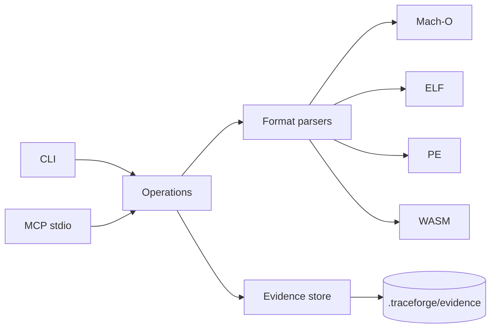

<p align="center">
  
</p>

<h1 align="center">TraceForge</h1>

<p align="center">
  <b>Evidence-first binary inspections. Local. Deterministic. Agent-ready.</b>
</p>

<p align="center">
  <a href="https://github.com/Mutersec/traceforge/actions/workflows/ci.yml"></a>
  <a href="https://github.com/Mutersec/traceforge/actions/workflows/codeql.yml"></a>
  <a href="LICENSE"></a>
  <a href="https://nodejs.org"></a>
  <a href="https://mutersec.github.io/traceforge/"></a>
  <a href="https://github.com/Mutersec/traceforge/releases"></a>
</p>

TraceForge is a small, read-only toolkit for inspecting native binaries and
keeping the result as verifiable Evidence. It does not execute the target, does
not upload data, and does not require a cloud service.

<p align="center">
  <a href="https://mutersec.github.io/traceforge/"><b>Live site</b></a>
</p>

<p align="center">
  
</p>

```console
$ tforge scan /bin/ls

TraceForge · scan

path     /bin/ls
sha256   13f44bfe1c4af602da4465c834dbe7b16a5441ccbd843178b36116ee23422bfb
size     252,512 bytes
format   mach-o

Slices
  x86_64  64-bit little  executable
    12 sections · 91 imports · 1 exports · 3 libraries
    nx · undetermined: pie
  arm64e  64-bit little  executable
    11 sections · 90 imports · 1 exports · 3 libraries
    chained-fixups, nx · undetermined: pie
  arm64_subtype_12  64-bit little  executable
    11 sections · 90 imports · 1 exports · 3 libraries
    chained-fixups, nx · undetermined: pie
Evidence ev_4881c15a0c4ae521f75e89d77d9abaca2cb5b6f68f32ce74cd005e58beb15e2a (scan)
```

## Why TraceForge

- **Read-only by construction.** Analysis never launches the target.
- **Evidence, not screenshots.** Every result has a content-addressed
  `evidence_id`, a SHA-256 input identity, limitations, and a local JSON record.
- **Mitigations and provenance, decoded.** Each slice states which structural
  protections are present, absent or undetermined, plus the build claims the
  container makes about itself.
- **Deterministic records.** Stable JSON canonicalization means the same input
  and result produce the same identity.
- **Agent-native.** A dependency-free MCP stdio server exposes the same core.
- **Zero telemetry.** No network calls, no accounts, no background service.
- **Small dependency surface.** Runtime code uses Node built-ins only.

## Install

```sh
git clone https://github.com/Mutersec/traceforge.git
cd traceforge
npm ci
npm run build
npm link            # optional: exposes `tforge` and `traceforge`
```

Or run without linking:

```sh
node dist/cli.js scan /bin/ls
```

## Commands

| Command | Purpose |
|---|---|
| `scan <path>` | Identify format, hashes, slices and collection counts. |
| `inspect <path>` | Full section, import, export and library inventory. Use `--arch` for one universal slice. |
| `app <package>` | Recursively inventory an `.app`, `.framework` or directory: one entry per member plus the identity its bundle manifest declares. |
| `diff <left> <right>` | Compare two binaries by identity, sections, symbols and mitigation changes. |
| `evidence list` | List local Evidence summaries. |
| `evidence show <id>` | Read one authenticated record. |
| `evidence verify <id>` | Recompute and verify a record. With `--public-key <path>` or `--signature <path>`, also check its Ed25519 signature. |
| `evidence verify-all` | Verify every local record, and count signed vs unsigned. |
| `evidence keygen` | Create an Ed25519 signing key pair in `.traceforge/keys`. |
| `evidence sign <id>` | Write a detached signature sidecar for one record. |
| `evidence export <path>` | Export a deterministic bundle. |
| `evidence import <path>` | Authenticate and merge a bundle. |
| `report <path\|package\|id>` | Write a standalone HTML Evidence report. |
| `mcp` | Start the MCP stdio server. |

Common flags: `--json`, `--store <dir>`, `--no-save`, `--debug`.
Use `--out report.html` with `report`; `npm run demo` runs the whole showcase.

Evidence is written to `.traceforge/evidence` by default. Use `--no-save` for a
one-shot inspection.

## Signing

```console
$ tforge evidence keygen
TraceForge · Ed25519 key

fingerprint pk_786bbd87c43f5f088dafb5f9ab7ed0b6765b5a11bf60fbaea819da88714205a4
private key /Users/emirhan/Desktop/TraceForge/.traceforge/keys/pk_786bbd87c43f5f088dafb5f9ab7ed0b6765b5a11bf60fbaea819da88714205a4.pem
public key  /Users/emirhan/Desktop/TraceForge/.traceforge/keys/pk_786bbd87c43f5f088dafb5f9ab7ed0b6765b5a11bf60fbaea819da88714205a4.pub.pem

Keep the private key offline. Anyone who holds it can sign records as you; share only the public key.

$ tforge evidence sign ev_4881c15a0c4ae521f75e89d77d9abaca2cb5b6f68f32ce74cd005e58beb15e2a
evidence  ev_4881c15a0c4ae521f75e89d77d9abaca2cb5b6f68f32ce74cd005e58beb15e2a
key       pk_786bbd87c43f5f088dafb5f9ab7ed0b6765b5a11bf60fbaea819da88714205a4
signature /Users/emirhan/Desktop/TraceForge/.traceforge/signatures/ev_4881c15a0c4ae521f75e89d77d9abaca2cb5b6f68f32ce74cd005e58beb15e2a.sig.json

$ tforge evidence verify ev_4881c15a0c4ae521f75e89d77d9abaca2cb5b6f68f32ce74cd005e58beb15e2a --public-key .traceforge/keys/pk_786bbd87c43f5f088dafb5f9ab7ed0b6765b5a11bf60fbaea819da88714205a4.pub.pem
signed · verified by pk_786bbd87c43f5f088dafb5f9ab7ed0b6765b5a11bf60fbaea819da88714205a4
```

A detached Ed25519 sidecar binds one key to one record and proves the record
bytes have not changed since it was signed. Signatures use Node's own crypto;
there are still zero runtime dependencies. The signed message is the ASCII
prefix `traceforge.signature.v1\n` plus the SHA-256 of the record's canonical
JSON — deterministic, no timestamp, nothing random. If you change the record,
`verify` fails with `The record changed after it was signed`. Keys and
sidecars live under `.traceforge/`, which git ignores, and are written 0600.
What a signature does not prove — no time, no revocation, no origin, and an
embedded key is only self-reported — is spelled out in
[docs/signing.md](docs/signing.md).

## Inspecting a whole application

```console
$ tforge app /Applications/Obsidian.app

TraceForge · app · app

path       /Applications/Obsidian.app
layout     macos
members    278 files · 322 dirs · 14 links · 513.6 MiB
tree       d018c5c536e162527560a18880baf0ca1dea189b734f849a88fc09e91382f37f
kinds      archive 2 · code 18 · link 14 · manifest 24 · other 4 · resource 228 · script 2
architectures arm64 18 · x86_64 18

Manifest Contents/Info.plist · xml · 40 keys
  sha256     7760bcb6e0d3c55a97d1b5952d2a83b348a91bf875d411e6639ce15324622abe
  CFBundleIdentifier            md.obsidian
  …

Declared executable Contents/MacOS/Obsidian present

Largest code members 18 mach-o · 0 wasm · 0 elf · 0 pe
  Contents/Frameworks/Electron Framework.framework/Versions/A/Electron Framework 378.9 MiB  mach-o arm64/x86_64
  Contents/Frameworks/Electron Framework.framework/Versions/A/Libraries/libvk_swiftshader.dylib  20.3 MiB  mach-o arm64/x86_64
  …
Evidence ev_... (app)
```

Every member of the package gets its own SHA-256, size and format label; the
`tree` line is a fingerprint over those member identities, so a directory has an
input identity even though it is not one file. The bundle manifest is recorded
as **declared** identity — `CFBundleIdentifier`, versions, minimum system — and
the record states that none of it was checked against a signature or a
notarization ticket. Archives (`.asar`, `.car`, `.zip`) are counted and hashed
but not opened, symbolic links are written down but never followed, and the walk
stops at 5,000 members or depth 32 and says so in `limitations` instead of
failing. `tforge report SomeApp.app` renders the same record as HTML.

## Evidence report

```sh
tforge report /bin/ls --out traceforge-report.html
```

The report is a standalone HTML file: identity badge, input hash, sections,
imports/exports and limitations. It is generated from the same authenticated
record and contains no external scripts.


See [docs/demo.md](docs/demo.md) for a three-minute non-technical and technical
demo script.

## MCP

Add TraceForge to any MCP client:

```json
{
  "mcpServers": {
    "traceforge": {
      "command": "node",
      "args": ["/absolute/path/to/traceforge/dist/cli.js", "mcp"],
      "env": {
        "NO_COLOR": "1"
      }
    }
  }
}
```

Tools:

- `scan_binary`
- `inspect_binary`
- `inspect_package`
- `compare_binaries`
- `get_evidence`
- `list_evidence`

The protocol is newline-delimited JSON-RPC 2.0 over stdio. See
[docs/mcp.md](docs/mcp.md).

## Supported formats

| Format | Inventory |
|---|---|
| Mach-O / universal | slices, sections, symbols, dylibs, UUID, entrypoint, mitigations, build-version claims |
| ELF32 / ELF64 | sections, symbols, `DT_NEEDED`, entrypoint, build-id, program headers, mitigations, producer claim |
| PE32 / PE32+ | sections, imports, exports, RVA entrypoint, `DllCharacteristics` mitigations, linker claims |
| WebAssembly | sections, imports, exports |
| `.app` / `.framework` / directory | recursive member inventory, per-member SHA-256 and format, declared bundle manifest, nested packages |
| Property list (XML, binary, JSON) | manifest keys and scalar claims, as declared identity |
| Unknown | input identity and a declared limitation |

Every mitigation name is a structural claim from container headers, never an
observation of runtime enforcement, and each decision rule is documented in
[docs/parsers.md](docs/parsers.md).

TraceForge is an inspector, not a disassembler. It does not reconstruct code or
execute targets. Stripped binaries may expose fewer symbols. Parser limits and
coverage are documented in [docs/parsers.md](docs/parsers.md).

## Architecture



The parsers own byte interpretation. Operations compose input identity, result
and limitations into one record. The store owns durability and authentication;
adapters never re-interpret parser facts.

## Safety

- Targets are opened read-only.
- Files larger than 512 MiB are rejected before parsing.
- Section hashing is capped at 64 MiB per section.
- A package walk stops at 5,000 members, depth 32 and 64 nested packages, and
  records the stop as a limitation instead of failing; members are labelled from
  a 64 KiB header window, and manifests from a 4 MiB read.
- Bounds, counts and string lengths are checked before allocation.
- Evidence is written atomically with owner-only permissions.
- Signing keys are written 0600 under the git-ignored `.traceforge/` tree; the
  file mode is the only guard, so keep the private key offline.
- The tool does not execute, attach to, or modify targets.

See [SECURITY.md](SECURITY.md) for reporting and [docs/roadmap.md](docs/roadmap.md)
for the next increments.

## Development

```sh
npm ci
npm run typecheck
npm test
npm run build
npm run check      # typecheck + tests + build
```

Tests cover synthetic ELF/PE/WASM fixtures, synthetic bundle trees with XML and
binary property lists, parser limits, Evidence integrity, Ed25519 signing and
tamper detection, bundle round-trips, MCP protocol and a real macOS Mach-O and
a real installed bundle when run on Darwin. CI runs on Node 22 and 24.

## Performance

Measured on an Apple Silicon arm64 host with Node 24, 25 iterations over a
252,512-byte universal Mach-O:

| Operation | Median | p95 | CPU median |
|---|---:|---:|---:|
| `inspect /bin/ls` | 0.46 ms | 0.68 ms | 0.49 ms |

The benchmark is local and parser-only; it does not execute the target or use a
network. Reproduce with `npm run bench -- /bin/ls`. These numbers are a starting
point, not a cross-tool comparison.

## License

[MIT](LICENSE) © 2026 Mutersec.
