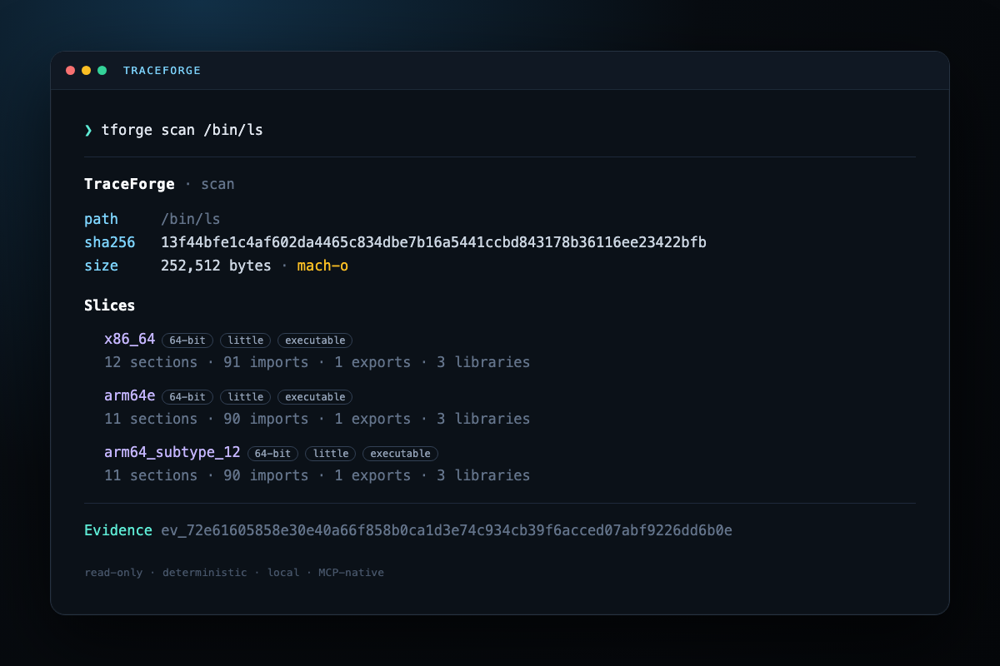
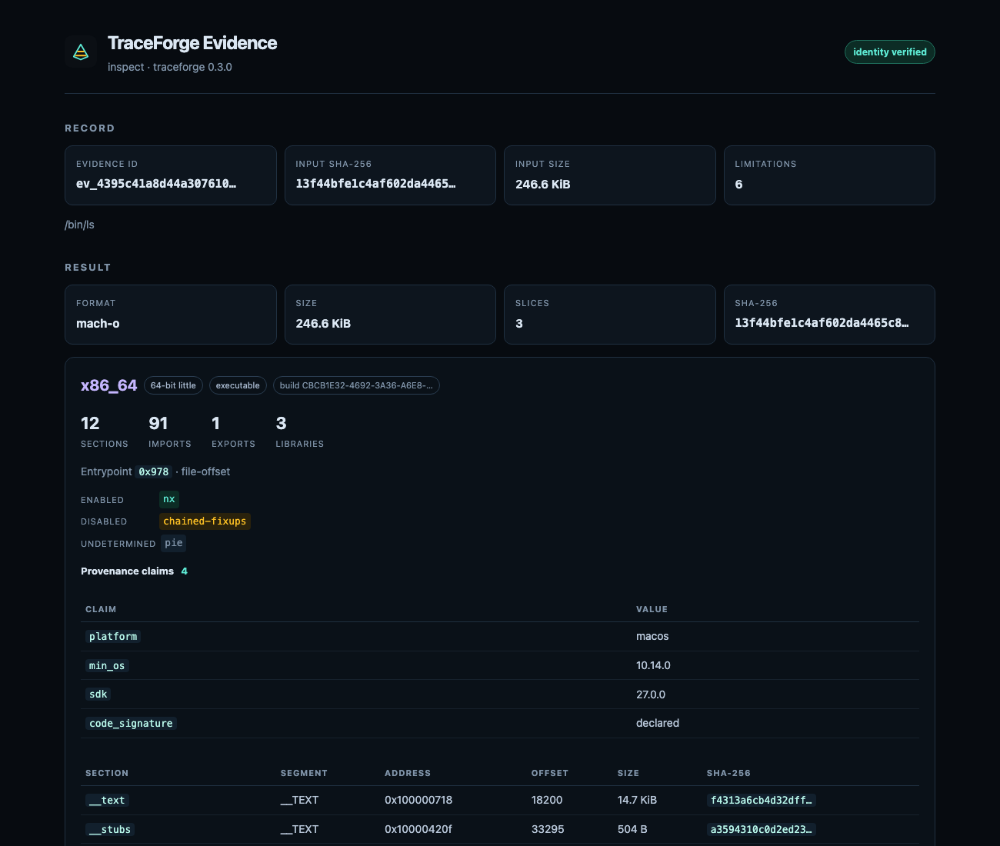
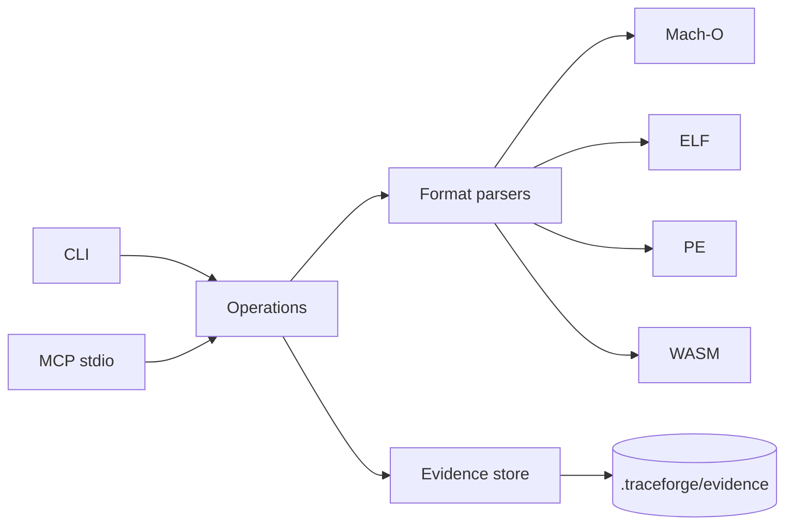

<p align="center">
  
</p>

<h1 align="center">TraceForge</h1>

<p align="center">
  <b>Evidence-first binary inspections. Local. Deterministic. Agent-ready.</b>
</p>

<p align="center">
  <a href="https://github.com/Mutersec/traceforge/actions/workflows/ci.yml"></a>
  <a href="https://github.com/Mutersec/traceforge/actions/workflows/codeql.yml"></a>
  <a href="LICENSE"></a>
  <a href="https://nodejs.org"></a>
  <a href="https://mutersec.github.io/traceforge/"></a>
  <a href="https://github.com/Mutersec/traceforge/releases"></a>
</p>

TraceForge is a small, read-only toolkit for inspecting native binaries and
keeping the result as verifiable Evidence. It does not execute the target, does
not upload data, and does not require a cloud service.

## What this does in 30 seconds

TraceForge reads a binary or an application bundle — it never runs it — writes
a verifiable Evidence record to disk, and renders that record as one standalone
HTML report you can open in any browser.

```sh
git clone https://github.com/Mutersec/traceforge.git
cd traceforge
npm ci
npm run build
node dist/cli.js app /Applications/Obsidian.app         # inventory the whole bundle
node dist/cli.js report /Applications/Obsidian.app --out report.html
open report.html                                        # the evidence, offline, in a browser
```

Every report carries a content-addressed `evidence_id`. The HTML alone is not
verifiable by someone else: verification recomputes the identity from the stored
record, so hand over the record too — `evidence export` writes a portable
bundle and `evidence import` authenticates it (`evidence verify <id>` answers
`invalid or missing` when the record is absent). A signature closes the gap
without moving the whole store: `evidence sign <id>` plus `evidence verify <id>
--public-key <file>`. No network, no account, no execution of the target.

*A plain-Turkish, jargon-free guide to reading a report — what each line
proves and what it does not — lives in
[docs/turkish-guide.md](docs/turkish-guide.md).*

<p align="center">
  <a href="https://mutersec.github.io/traceforge/"><b>Live site</b></a>
</p>

<p align="center">
  
</p>

```console
$ tforge scan /bin/ls

TraceForge · scan

path     /bin/ls
sha256   13f44bfe1c4af602da4465c834dbe7b16a5441ccbd843178b36116ee23422bfb
size     252,512 bytes
format   mach-o

Slices
  x86_64  64-bit little  executable
    12 sections · 91 imports · 1 exports · 3 libraries
    nx · undetermined: pie
  arm64e  64-bit little  executable
    11 sections · 90 imports · 1 exports · 3 libraries
    chained-fixups, nx · undetermined: pie
  arm64_subtype_12  64-bit little  executable
    11 sections · 90 imports · 1 exports · 3 libraries
    chained-fixups, nx · undetermined: pie
Evidence ev_72e61605858e30e40a66f858b0ca1d3e74c934cb39f6acced07abf9226dd6b0e (scan)
```

*Every console block in this README is real output, captured on 2026-11-02 on
an Apple Silicon MacBook (darwin/arm64, Node v24.20.0).*

## Why TraceForge

- **Read-only by construction.** Analysis never launches the target.
- **Evidence, not screenshots.** Every result has a content-addressed
  `evidence_id`, a SHA-256 input identity, limitations, and a local JSON record.
- **Mitigations and provenance, decoded.** Each slice states which structural
  protections are present, absent or undetermined, plus the build claims the
  container makes about itself.
- **Deterministic records.** Stable JSON canonicalization means the same input
  and result produce the same identity.
- **Agent-native.** A dependency-free MCP stdio server exposes the same core.
- **Zero telemetry.** No network calls, no accounts, no background service.
- **Small dependency surface.** Runtime code uses Node built-ins only.

## Install

```sh
git clone https://github.com/Mutersec/traceforge.git
cd traceforge
npm ci
npm run build
npm link            # optional: exposes `tforge` and `traceforge`
```

Or run without linking:

```sh
node dist/cli.js scan /bin/ls
```

## Commands

| Command | Purpose |
|---|---|
| `scan <path>` | Identify format, hashes, slices and collection counts. |
| `inspect <path>` | Full section, import, export and library inventory. Use `--arch` for one universal slice. |
| `app <package>` | Recursively inventory an `.app`, `.framework` or directory: one entry per member plus the identity its bundle manifest declares. Supports `--only` and `--limit`/`--cursor`. |
| `diff <left> <right>` | Compare two binaries by identity, sections, symbols and mitigation changes. |
| `evidence list` | List local Evidence summaries. |
| `evidence show <id>` | Read one authenticated record. |
| `evidence verify <id>` | Recompute and verify a record. With `--public-key <path>` or `--signature <path>`, also check its Ed25519 signature. |
| `evidence verify-all` | Verify every local record, and count signed vs unsigned. |
| `evidence keygen` | Create an Ed25519 signing key pair in `.traceforge/keys`. |
| `evidence sign <id>` | Write a detached signature sidecar for one record. |
| `evidence export <path>` | Export a deterministic bundle. |
| `evidence import <path>` | Authenticate and merge a bundle. |
| `report <path\|package\|id>` | Write a standalone HTML Evidence report. |
| `mcp` | Start the MCP stdio server. |

Common flags: `--json`, `--store <dir>`, `--no-save`, `--debug`. For
agent-sized answers: `--only <fields>`, `--limit <n>`, `--cursor <offset>`.
Use `--out report.html` with `report`; `npm run demo` runs the whole showcase.

Evidence is written to `.traceforge/evidence` by default. Use `--no-save` for a
one-shot inspection.

## Signing

```console
$ tforge evidence keygen
TraceForge · Ed25519 key

fingerprint pk_786bbd87c43f5f088dafb5f9ab7ed0b6765b5a11bf60fbaea819da88714205a4
private key /Users/emirhan/Desktop/TraceForge/.traceforge/keys/pk_786bbd87c43f5f088dafb5f9ab7ed0b6765b5a11bf60fbaea819da88714205a4.pem
public key  /Users/emirhan/Desktop/TraceForge/.traceforge/keys/pk_786bbd87c43f5f088dafb5f9ab7ed0b6765b5a11bf60fbaea819da88714205a4.pub.pem

Keep the private key offline. Anyone who holds it can sign records as you; share only the public key.

$ tforge evidence sign ev_72e61605858e30e40a66f858b0ca1d3e74c934cb39f6acced07abf9226dd6b0e
evidence  ev_72e61605858e30e40a66f858b0ca1d3e74c934cb39f6acced07abf9226dd6b0e
key       pk_786bbd87c43f5f088dafb5f9ab7ed0b6765b5a11bf60fbaea819da88714205a4
signature /Users/emirhan/Desktop/TraceForge/.traceforge/signatures/ev_72e61605858e30e40a66f858b0ca1d3e74c934cb39f6acced07abf9226dd6b0e.sig.json

$ tforge evidence verify ev_72e61605858e30e40a66f858b0ca1d3e74c934cb39f6acced07abf9226dd6b0e --public-key .traceforge/keys/pk_786bbd87c43f5f088dafb5f9ab7ed0b6765b5a11bf60fbaea819da88714205a4.pub.pem
signed · verified by pk_786bbd87c43f5f088dafb5f9ab7ed0b6765b5a11bf60fbaea819da88714205a4
```

After that, the record was rewritten (one byte of `input.size` changed in the
JSON under `.traceforge/evidence`) and re-verified:

```console
$ tforge evidence verify ev_72e61605858e30e40a66f858b0ca1d3e74c934cb39f6acced07abf9226dd6b0e --public-key .traceforge/keys/pk_786bbd87c43f5f088dafb5f9ab7ed0b6765b5a11bf60fbaea819da88714205a4.pub.pem
error [signature_mismatch]: The record changed after it was signed (record hash differs).
$ echo $?
1
```

*(The tamper step was run in a throwaway `--store` copy so the shipped store
stayed at `0 invalid`; the CLI output above is verbatim.)*

A detached Ed25519 sidecar binds one key to one record and proves the record
bytes have not changed since it was signed. Signatures use Node's own crypto;
there are still zero runtime dependencies. The signed message is the ASCII
prefix `traceforge.signature.v1\n` plus the SHA-256 of the record's canonical
JSON — deterministic, no timestamp, nothing random. If you change the record,
`verify` fails with `The record changed after it was signed`. Keys and
sidecars live under `.traceforge/`, which git ignores, and are written 0600.
What a signature does not prove — no time, no revocation, no origin, and an
embedded key is only self-reported — is spelled out in
[docs/signing.md](docs/signing.md).

## Inspecting a whole application

```console
$ tforge app /Applications/AirStats.app

TraceForge · app · app

path       /Applications/AirStats.app
layout     macos
members    95 files · 65 dirs · 9 links · 8.8 MiB
tree       c575f6ca4c51bbee69890d25513242b68cbeb1c3ea9043a18d66c023944bcb6e
kinds      code 6 · link 9 · manifest 13 · other 32 · resource 44
architectures arm64 6 · x86_64 5

Manifest Contents/Info.plist · xml · 21 keys
  sha256     d5a92d051e38802d4caa6320aed420f0ee9a4c10e7897cc43a29a0aec6bbdfc1
  CFBundleIdentifier            com.airstat.AirStats
  CFBundleName                  AirStats
  CFBundleDisplayName           AirStats
  CFBundleExecutable            AirStats
  CFBundleShortVersionString    1.3.2
  CFBundleVersion               8
  CFBundlePackageType           APPL
  …

Nested packages 5
  Contents/Frameworks/Sparkle.framework
    framework  no declared identifier
  Contents/Frameworks/Sparkle.framework/Versions/B/Updater.app
    app  org.sparkle-project.Sparkle.Updater
  Contents/Frameworks/Sparkle.framework/Versions/B/XPCServices/Downloader.xpc
    xpc-service  org.sparkle-project.DownloaderService
  Contents/Frameworks/Sparkle.framework/Versions/B/XPCServices/Installer.xpc
    xpc-service  org.sparkle-project.InstallerLauncher
  Contents/Resources/AirStats_AirStatUI.bundle
    bundle  no declared identifier
Evidence ev_8e6ff9bf617a35853592297b528301e9908549ef212861c4bed9bfc22ecb378e (app)
```

Every member of the package gets its own SHA-256, size and format label; the
`tree` line is a fingerprint over those member identities, so a directory has an
input identity even though it is not one file. The bundle manifest is recorded
as **declared** identity — `CFBundleIdentifier`, versions, minimum system — and
the record states that none of it was checked against a signature or a
notarization ticket. Archives (`.asar`, `.car`, `.zip`) are counted and hashed
but not opened, symbolic links are written down but never followed, and the walk
stops at 5,000 members or depth 32 and says so in `limitations` instead of
failing. `tforge report SomeApp.app` renders the same record as HTML.

## Evidence report

```console
$ tforge report /bin/ls --out traceforge-report.html
TraceForge report → /Users/emirhan/Desktop/TraceForge/traceforge-report.html
Evidence ev_4395c41a8d44a30761004a29fa7cbeefe77330f9bf1e74587a01b8c632729d76
```

The report is a standalone HTML file (27,918 bytes for `/bin/ls`): identity
badge, input hash, sections, imports/exports and limitations. It is generated
from the same authenticated record and contains no external scripts. Wide
member/section tables sit in a horizontally scrollable `.table-wrap`, and long
paths and hashes use `overflow-wrap: anywhere`, so a 177-character member path
or the 64-hex Evidence ID in the footer never breaks the layout on a phone or a
narrow window.

One limit worth stating plainly: the HTML itself is not tamper-evident. It
carries no script and does not embed the full canonical record, so verification
reads the stored record, not the page. Send the record (`evidence export`) or a
signature (`evidence sign`) alongside the report if the recipient must be able
to detect an edit. Measured on this machine: editing a committed gallery report
changed nothing for `evidence verify`, which still reported `valid`.



See [docs/demo.md](docs/demo.md) for a three-minute non-technical and technical
demo script, and the [Evidence gallery](#evidence-gallery) for four real reports.

## Evidence gallery

Four standalone HTML reports, written by `tforge report` against applications
really installed on one Apple Silicon MacBook, then committed unchanged. Open
any file in a browser: it fetches nothing and runs nothing.

| Report | Path | What it proves |
|---|---|---|
| AirStats | [`examples/gallery/airstats.html`](examples/gallery/airstats.html) | An app that contains other apps: 5 nested packages, including a Sparkle `Updater.app` and two `.xpc` services. |
| Obsidian | [`examples/gallery/obsidian.html`](examples/gallery/obsidian.html) | A real 378.9 MiB member hashed in one pass, with the `.asar` archives counted but honestly not opened. |
| Qoder | [`examples/gallery/qoder.html`](examples/gallery/qoder.html) | The walk hitting its 5,000-member cap and writing the stop into `limitations`. |
| Riot Client | [`examples/gallery/riot-client.html`](examples/gallery/riot-client.html) | A symlinked bundle root with a non-ASCII (`İ`) path resolved and carried through. |

Each also exists under `site/gallery/` for the live site. The four Evidence IDs
and exact byte sizes are pinned in
[examples/README.md](examples/README.md). Regenerate the whole set with the
CLI-only script:

```sh
node scripts/gallery.mjs          # writes examples/gallery + site/gallery
node scripts/gallery.mjs --check  # fresh run in a temp dir, byte-compared, writes nothing
```

Budget: one report ≤ 700 KiB, gallery total ≤ 2 MiB. On this bump the four
reports are `37,577 / 81,587 / 83,914 / 79,604 B` (282,682 B total), each well
under the cap.

## Determinism

The `evidence_id` is a SHA-256 over the canonical JSON of the record, and that
record includes the tool version. Two facts follow, and both are real:

- **Same command, same input, same version → same ID.** Running `tforge scan
  /bin/ls --no-save` twice on 2026-11-02 produced the identical ID both times:

  ```text
  ev_72e61605858e30e40a66f858b0ca1d3e74c934cb39f6acced07abf9226dd6b0e   (scan 1)
  ev_72e61605858e30e40a66f858b0ca1d3e74c934cb39f6acced07abf9226dd6b0e   (scan 2)
  ```

- **Same file, different tool version → different ID.** Bumping `VERSION` from
  `0.2.0` to `0.3.0` changed the ID for the *exact same* `/bin/ls` bytes,
  because `tool.version` is part of the hashed content. This is not a hash
  change in the file — the input SHA-256 (`13f44bfe…22bfb`) is identical — it
  is the version label moving the identity, on purpose:

  ```text
  0.2.0: ev_4881c15a0c4ae521f75e89d77d9abaca2cb5b6f68f32ce74cd005e58beb15e2a
  0.3.0: ev_72e61605858e30e40a66f858b0ca1d3e74c934cb39f6acced07abf9226dd6b0e
  ```

  These IDs belong to **this host's** `/bin/ls`. Another machine ships a
  different `/bin/ls`, so it produces a different ID — on GitHub's macOS runner
  the same command yields `ev_406547ca6a1a583e8abf56fac45ebaf018f2d5d824e9fe1ba72848e13a5531d5`.
  What holds on every host is the self-consistency above, so no test pins a
  host-specific ID.

  ⚠ When you bump the version, every example ID in this README, in `docs/`, in
  the CHANGELOG, and in the gallery must be regenerated after the bump — an old
  ID will not reproduce on the new build. The gallery script re-runs the CLI, so
  it always emits current-version IDs.


## MCP

Add TraceForge to any MCP client:

```json
{
  "mcpServers": {
    "traceforge": {
      "command": "node",
      "args": ["/absolute/path/to/traceforge/dist/cli.js", "mcp"],
      "env": {
        "NO_COLOR": "1"
      }
    }
  }
}
```

Tools:

- `scan_binary`
- `inspect_binary`
- `inspect_package`
- `compare_binaries`
- `get_evidence`
- `list_evidence`

The protocol is newline-delimited JSON-RPC 2.0 over stdio. See
[docs/mcp.md](docs/mcp.md).

## Agent ergonomics

One answer per big binary or package should never balloon into MiB of JSON.

- `--only` keeps just what you asked for. `inspect` accepts `sections,
  imports, exports, libraries, provenance, security`; `app` accepts `files,
  manifest, nested, limitations`. Unselected fields are removed from the
  answer and named in `omitted`; a stored record always stays complete.
- `--limit <1-500>` with `--cursor <offset>` pages member and symbol lists
  in `--json` and MCP answers. Follow `page.next_cursor` until it is `null`.
- MCP caps one tool answer at 256 KiB of text: an oversized `detail=complete`
  degrades to summary with `truncated: true` and a hint instead of a MiB blob.
- MCP resources: `traceforge://evidence`, `traceforge://evidence/{evidence_id}`
  and `traceforge://store` — counts and state only, key files are never read.

```console
$ tforge app /Applications/Obsidian.app --json --only files --limit 2
{ "evidence_id": "ev_eb9eb2ef46957214978eba85c1278b5b34ef2b32c869dd28dc1522aaa6e2b271",
  "detail": "complete",
  "page": { "limit": 2, "returned": 2, "next_cursor": "2", "total": 292 },
  "inventory": { "...": "2 of 292 members" }, "omitted": ["manifest", "nested", "limitations"] }
```

Paging is a transport convenience, not an evidence boundary.

## Supported formats

| Format | Inventory |
|---|---|
| Mach-O / universal | slices, sections, symbols, dylibs, UUID, entrypoint, mitigations, build-version claims |
| ELF32 / ELF64 | sections, symbols, `DT_NEEDED`, entrypoint, build-id, program headers, mitigations, producer claim |
| PE32 / PE32+ | sections, imports, exports, RVA entrypoint, `DllCharacteristics` mitigations, linker claims |
| WebAssembly | sections, imports, exports |
| `.app` / `.framework` / directory | recursive member inventory, per-member SHA-256 and format, declared bundle manifest, nested packages |
| Property list (XML, binary, JSON) | manifest keys and scalar claims, as declared identity |
| Unknown | input identity and a declared limitation |

Every mitigation name is a structural claim from container headers, never an
observation of runtime enforcement, and each decision rule is documented in
[docs/parsers.md](docs/parsers.md).

TraceForge is an inspector, not a disassembler. It does not reconstruct code or
execute targets. Stripped binaries may expose fewer symbols. Parser limits and
coverage are documented in [docs/parsers.md](docs/parsers.md).

## Architecture



The parsers own byte interpretation. Operations compose input identity, result
and limitations into one record. The store owns durability and authentication;
adapters never re-interpret parser facts.

## Safety

- Targets are opened read-only.
- Files larger than 512 MiB are rejected before parsing.
- Section hashing is capped at 64 MiB per section.
- A package walk stops at 5,000 members, depth 32 and 64 nested packages, and
  records the stop as a limitation instead of failing; members are labelled from
  a 64 KiB header window, and manifests from a 4 MiB read.
- Symbolic links are recorded with their target text but never followed or
  opened; pipes and sockets are skipped so a read can never block.
- Archives (`.asar`, `.car`, `.zip`) are counted and hashed but never opened —
  the record states that their contents were not inspected, and no file inside
  an `.asar` is ever listed.
- Bounds, counts and string lengths are checked before allocation.
- Evidence is written atomically with owner-only permissions.
- Signing keys are written 0600 under the git-ignored `.traceforge/` tree; the
  file mode is the only guard, so keep the private key offline.
- The tool does not execute, attach to, or modify targets.

What a signature does **not** prove (all of these, deliberately): no timestamp
or timestamping authority, so it cannot say when a record was signed; no key
revocation, so a compromised key keeps verifying; it is not a code signature and
says nothing about Apple codesign, notarization or Authenticode origin; and an
embedded key with no `--public-key` is only self-reported. See
[docs/signing.md](docs/signing.md) for the full model and
[SECURITY.md](SECURITY.md) for reporting. The delivered/open split for the
current release is in [docs/roadmap.md](docs/roadmap.md).

## Development

```sh
npm ci
npm run typecheck
npm test
npm run build
npm run check      # typecheck + tests + build

# the same gates CI runs, locally
BENCH_ITERATIONS=25 npm run bench --silent | node scripts/bench-gate.mjs
npm pack --dry-run --json | node scripts/package-audit.mjs
npm publish --dry-run          # offline: packs, runs prepublishOnly, publishes nothing
```

Tests cover synthetic ELF/PE/WASM fixtures, synthetic bundle trees with XML and
binary property lists, parser limits, Evidence integrity, Ed25519 signing and
tamper detection, bundle round-trips, MCP protocol and a real macOS Mach-O and
a real installed bundle when run on Darwin. CI runs the matrix
ubuntu-latest × macos-latest on Node 22 and 24 (fail-fast off): `npm run
check`, a live smoke set (synthetic package through `app --no-save`, then
`scan`/`inspect --only`/`diff`/`report` on the runner's own `/bin/ls`, an MCP
stdio session asserting the six tool names in order and the 256 KiB answer
ceiling, and the full keygen → sign → verify lifecycle in a throwaway store
whose keys are deleted at job end and never uploaded), the benchmark smoke
ceiling above, and the package gates. Platform guards matter for reading CI:
the real Mach-O, real-bundle, live-CLI-signing and live-paging test bodies
early-return on Linux (they run on the macOS leg), and the real-ELF test
early-returns on macOS (it runs on the Ubuntu leg) — so four red-free legs do
not mean the same test bodies ran on each. `scan /bin/ls` on this machine must
still hash to `ev_72e61605858e30e40a66f858b0ca1d3e74c934cb39f6acced07abf9226dd6b0e`
(the pinned value tracks `VERSION`, so it moves with every version bump — see
[Determinism](#determinism));
CI instead proves determinism by scanning the runner's own `/bin/ls` twice and
comparing ids, because runner binaries differ per image.

## Performance

Measured on an Apple Silicon arm64 host with Node 24.20.0, 25 iterations over a
252,512-byte universal Mach-O (`/bin/ls`), on 2026-11-02:

| Operation | Median | p95 | CPU median |
|---|---:|---:|---:|
| `inspect /bin/ls` | 0.47 ms | 0.59 ms | 1.04 ms |

Reproduce with `npm run bench -- /bin/ls` (it rebuilds first). The benchmark is
local and parser-only; it does not execute the target or use a network. These
numbers are a starting point, not a cross-tool comparison. CI runs the benchmark
too, but its gate is a wide smoke ceiling (median ≤ 10 ms, p95 ≤ 25 ms on 25
iterations), **not** a regression comparison: shared-runner noise makes one CI
sample unfit to catch a real slowdown, and no cross-run baseline artifact is
retained to compare against yet. See [bench/README.md](bench/README.md).

## License

[MIT](LICENSE) © 2026 Mutersec.
