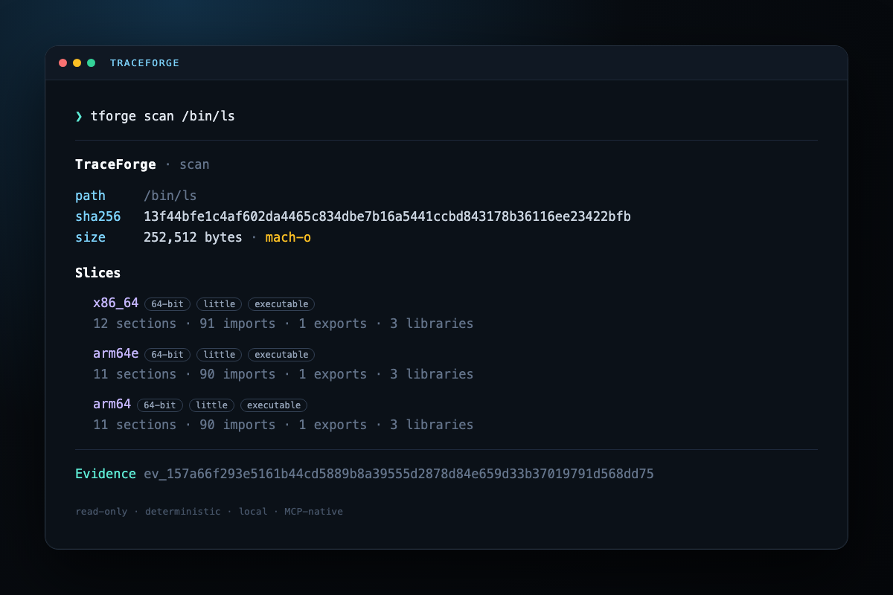
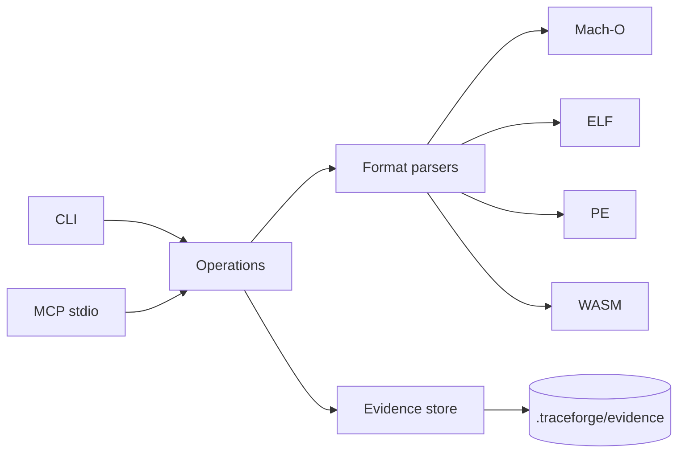

<p align="center">
  
</p>

<h1 align="center">TraceForge</h1>

<p align="center">
  <b>Evidence-first binary inspections. Local. Deterministic. Agent-ready.</b>
</p>

<p align="center">
  <a href="https://github.com/Mutersec/traceforge/actions/workflows/ci.yml"></a>
  <a href="https://github.com/Mutersec/traceforge/actions/workflows/codeql.yml"></a>
  <a href="LICENSE"></a>
  <a href="https://nodejs.org"></a>
  <a href="https://mutersec.github.io/traceforge/"></a>
  <a href="https://github.com/Mutersec/traceforge/releases"></a>
</p>

TraceForge is a small, read-only toolkit for inspecting native binaries and
keeping the result as verifiable Evidence. It does not execute the target, does
not upload data, and does not require a cloud service.

<p align="center">
  <a href="https://mutersec.github.io/traceforge/"><b>Live site</b></a>
</p>

<p align="center">
  
</p>

```console
$ tforge scan /bin/ls

TraceForge · scan

path     /bin/ls
sha256   13f44bfe1c4af602da4465c834dbe7b16a5441ccbd843178b36116ee23422bfb
size     252,512 bytes
format   mach-o

Slices
  x86_64  64-bit little  executable
    12 sections · 91 imports · 1 exports · 3 libraries
  arm64e  64-bit little  executable
    11 sections · 90 imports · 1 exports · 3 libraries
  arm64   64-bit little  executable
    11 sections · 90 imports · 1 exports · 3 libraries
Evidence ev_157a66f293e5161b44cd5889b8a39555d2878d84e659d33b37019791d568dd75 (scan)
```

## Why TraceForge

- **Read-only by construction.** Analysis never launches the target.
- **Evidence, not screenshots.** Every result has a content-addressed
  `evidence_id`, a SHA-256 input identity, limitations, and a local JSON record.
- **Deterministic records.** Stable JSON canonicalization means the same input
  and result produce the same identity.
- **Agent-native.** A dependency-free MCP stdio server exposes the same core.
- **Zero telemetry.** No network calls, no accounts, no background service.
- **Small dependency surface.** Runtime code uses Node built-ins only.

## Install

```sh
git clone https://github.com/Mutersec/traceforge.git
cd traceforge
npm ci
npm run build
npm link            # optional: exposes `tforge` and `traceforge`
```

Or run without linking:

```sh
node dist/cli.js scan /bin/ls
```

## Commands

| Command | Purpose |
|---|---|
| `scan <path>` | Identify format, hashes, slices and collection counts. |
| `inspect <path>` | Full section, import, export and library inventory. Use `--arch` for one universal slice. |
| `diff <left> <right>` | Compare two binaries by identity, sections and symbols. |
| `evidence list` | List local Evidence summaries. |
| `evidence show <id>` | Read one authenticated record. |
| `evidence verify <id>` | Recompute and verify a record. |
| `evidence verify-all` | Verify every local record. |
| `evidence export <path>` | Export a deterministic bundle. |
| `evidence import <path>` | Authenticate and merge a bundle. |
| `mcp` | Start the MCP stdio server. |

Common flags: `--json`, `--store <dir>`, `--no-save`, `--debug`.

Evidence is written to `.traceforge/evidence` by default. Use `--no-save` for a
one-shot inspection.

## MCP

Add TraceForge to any MCP client:

```json
{
  "mcpServers": {
    "traceforge": {
      "command": "node",
      "args": ["/absolute/path/to/traceforge/dist/cli.js", "mcp"],
      "env": {
        "NO_COLOR": "1"
      }
    }
  }
}
```

Tools:

- `scan_binary`
- `inspect_binary`
- `compare_binaries`
- `get_evidence`
- `list_evidence`

The protocol is newline-delimited JSON-RPC 2.0 over stdio. See
[docs/mcp.md](docs/mcp.md).

## Supported formats

| Format | Inventory |
|---|---|
| Mach-O / universal | slices, sections, symbols, dylibs, UUID, entrypoint |
| ELF32 / ELF64 | sections, symbols, `DT_NEEDED`, entrypoint, build-id |
| PE32 / PE32+ | sections, imports, exports, RVA entrypoint |
| WebAssembly | sections, imports, exports |
| Unknown | input identity and a declared limitation |

TraceForge is an inspector, not a disassembler. It does not reconstruct code or
execute targets. Stripped binaries may expose fewer symbols. Parser limits and
coverage are documented in [docs/parsers.md](docs/parsers.md).

## Architecture



The parsers own byte interpretation. Operations compose input identity, result
and limitations into one record. The store owns durability and authentication;
adapters never re-interpret parser facts.

## Safety

- Targets are opened read-only.
- Files larger than 512 MiB are rejected before parsing.
- Section hashing is capped at 64 MiB per section.
- Bounds, counts and string lengths are checked before allocation.
- Evidence is written atomically with owner-only permissions.
- The tool does not execute, attach to, or modify targets.

See [SECURITY.md](SECURITY.md) for reporting and [docs/roadmap.md](docs/roadmap.md)
for the next increments.

## Development

```sh
npm ci
npm run typecheck
npm test
npm run build
npm run check      # typecheck + tests + build
```

Tests cover synthetic ELF/PE/WASM fixtures, Evidence integrity, bundle
round-trips, MCP protocol and a real macOS Mach-O when run on Darwin. CI runs on
Node 22 and 24.

## Performance

Measured on an Apple Silicon arm64 host with Node 24, 25 iterations over a
252,512-byte universal Mach-O:

| Operation | Median | p95 | CPU median |
|---|---:|---:|---:|
| `inspect /bin/ls` | 0.46 ms | 0.68 ms | 0.49 ms |

The benchmark is local and parser-only; it does not execute the target or use a
network. Reproduce with `npm run bench -- /bin/ls`. These numbers are a starting
point, not a cross-tool comparison.

## License

[MIT](LICENSE) © 2026 Mutersec.
