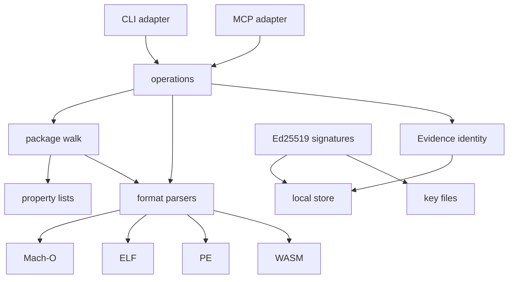

# Architecture

TraceForge separates byte interpretation, evidence identity, and delivery
adapters.

## Boundaries

- `src/core/macho.ts`, `elf.ts`, `pe.ts`, `wasm.ts` own format interpretation.
- `src/core/app.ts` owns the recursive package walk: member enumeration, kind
  classification, per-member identity and the tree fingerprint. It reads a
  bounded header window through `binary.ts` instead of loading members.
- `src/core/plist.ts` owns property list decoding (XML, binary, JSON) for bundle
  manifests; it interprets no other file and trusts no value.
- `src/core/binary.ts` detects the format, computes input identity, and composes
  inventories and comparisons.
- `src/core/evidence.ts` owns canonical content hashing, atomic persistence and
  authentication.
- `src/core/signature.ts` owns Ed25519 keys, the signed-message format and the
  detached sidecar store beside the record tree. It reads record bytes but
  never reinterprets them; the domain-separated message and the verification
  order are documented in [docs/signing.md](signing.md).
- `src/core/operations.ts` is the shared application workflow used by both
  adapters.
- `src/core/paging.ts` owns `--only`/`only` field selection and offset paging
  for answers. It runs after the record exists and never touches hashed
  record content: a paged or filtered answer is a transport view, the stored
  Evidence stays complete.
- `src/core/report.ts` renders one authenticated record into a standalone HTML
  file. It escapes every target-supplied string, keeps wide tables inside a
  scrollable wrapper, and never changes a byte of the record — two renders of
  one record are byte-identical.
- `src/cli.ts` and `src/mcp/server.ts` only parse transport input and present
  results.

## Determinism

Evidence IDs hash canonical JSON containing the schema, operation, tool version,
input identity, result, and limitations. No timestamp, random value, or display
formatting is part of the identity. A changed tool version or result produces a
different ID rather than silently reusing a record.

## Read-only boundary

No parser executes or maps the target. All reads are bounded by a 512 MiB file
limit, 64 MiB per-section hash limit, and explicit collection caps. The tool
returns limitations when it cannot establish a complete observation.

A package scan holds the same line: symbolic links are recorded, never followed
(`lstat`-style metadata only, no `readlink` target is opened); special files such
as pipes and sockets are skipped because reading them could block; members are
labelled from a 64 KiB window rather than loaded into memory; and every cap that
stops the walk is written into `limitations` so the record states its own holes.
