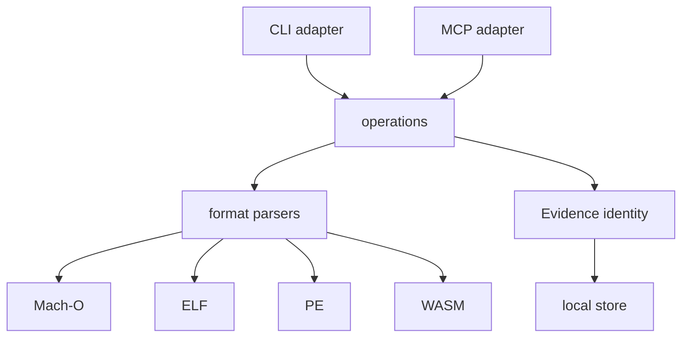

# Architecture

TraceForge separates byte interpretation, evidence identity, and delivery
adapters.

## Boundaries

- `src/core/macho.ts`, `elf.ts`, `pe.ts`, `wasm.ts` own format interpretation.
- `src/core/binary.ts` detects the format, computes input identity, and
  composes inventories and comparisons.
- `src/core/evidence.ts` owns canonical content hashing, atomic persistence and
  authentication.
- `src/core/operations.ts` is the shared application workflow used by both
  adapters.
- `src/cli.ts` and `src/mcp/server.ts` only parse transport input and present
  results.

## Determinism

Evidence IDs hash canonical JSON containing the schema, operation, tool version,
input identity, result, and limitations. No timestamp, random value, or display
formatting is part of the identity. A changed tool version or result produces a
different ID rather than silently reusing a record.

## Read-only boundary

No parser executes or maps the target. All reads are bounded by a 512 MiB file
limit, 64 MiB per-section hash limit, and explicit collection caps. The tool
returns limitations when it cannot establish a complete observation.
